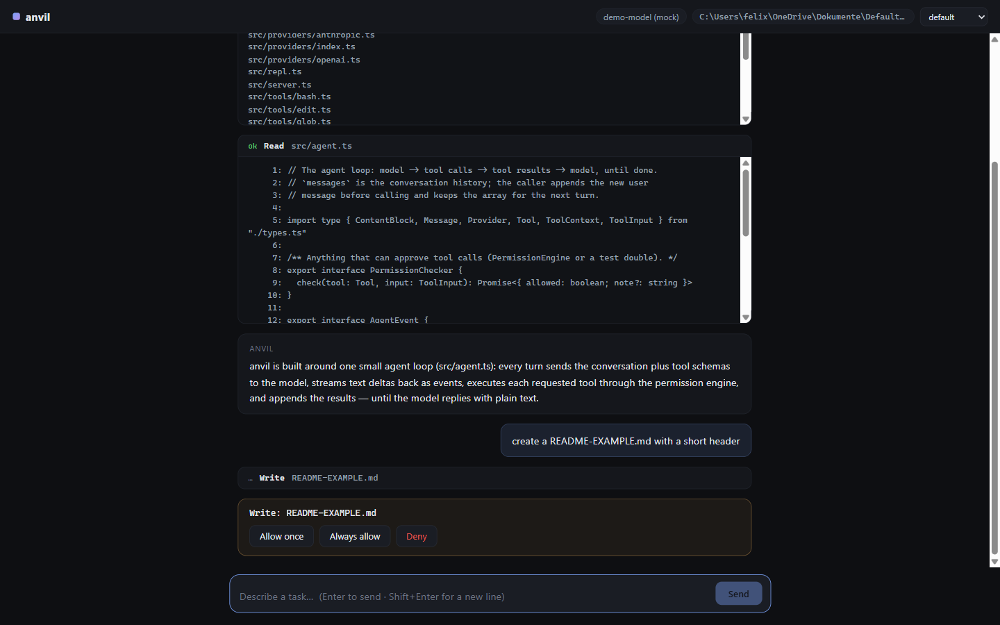

# anvil

**An open-source coding agent that lives in your terminal — and in your browser.**

anvil is a small, readable, MIT-licensed coding agent written in plain
TypeScript (no build step, no runtime dependencies). Point it at a task and it
reads, edits, searches, and runs commands in your project until the task is
done — with a permission system that keeps you in control.

> anvil is an independent, original implementation. It contains no code,
> prompts, or assets from any other product, and is not affiliated with or
> endorsed by Anthropic or OpenAI.

<p align="center">
  
</p>

## Features

- **Agent loop with streaming** — the model proposes tool calls, anvil
  executes them, results go back to the model, until the task is done or the
  turn limit is hit. Model text is streamed token by token (CLI and web).
- **Robust loop** — transient provider errors (rate limits, overloads, network
  blips) are retried with exponential backoff, and a reply cut off by the
  token limit is continued automatically instead of being handed back
  truncated.
- **Three providers** — Anthropic Messages API, any OpenAI-compatible
  endpoint (`OPENAI_BASE_URL`), and the HSNR gateway (`ai.ide3.de`, models
  `Qwen/Qwen3.8-27B`, `zai-org/GLM-5.3`, `ultrabrain`, `smallbrain`), selected
  by `--provider`, the settings dialog, or by which API key is set.
- **Model & thinking settings** — choose the model and an extended-thinking
  effort (`off` / `low` / `medium` / `high`) in the web UI settings dialog,
  via `anvil config`, a CLI flag, or environment variables. Effort maps to
  Anthropic thinking budgets and OpenAI `reasoning_effort`; thinking streams
  back as its own collapsible block in the UI and is kept in the conversation
  history as the APIs require.
- **Core tools** — `Read`, `Write`, `Edit` (exact-match replacement), `Bash`,
  `Glob`, `Grep`, `TodoWrite`, and `Task` (subagents with their own context
  window).
- **Permission modes** — `default` (ask once/always/deny), `acceptEdits`
  (auto-approve file edits), `plan` (strictly read-only), `bypass` (no
  prompts).
- **Memory** — project instructions from `ANVIL.md` in the working directory
  and user instructions from `~/.anvil/ANVIL.md` are loaded into the system
  prompt.
- **Web UI** — `anvil server` starts a dependency-free REST + SSE server with
  a modern web interface: streamed markdown answers with syntax-highlighted
  code blocks, a session sidebar with auto-titles and status dots, a live
  todo panel, collapsible tool-call chips, in-browser permission prompts,
  a settings dialog for provider/keys/model/thinking, light/dark themes, and
  a red stop button that aborts a running turn.
- **Multi-turn sessions** — the CLI REPL and web sessions keep the full
  conversation history across turns.

## Quickstart (CLI)

Requires **Node.js ≥ 23.6** (native TypeScript — no build step, no runtime dependencies).

**Via npm** (installs the `anvil` command):

```sh
npm install -g anvil-code

anvil config set anthropic-key sk-ant-...      # store your key once (or use env vars)
anvil config set model claude-sonnet-4-5       # optional: pick model + thinking
anvil config set thinking medium
anvil "fix the failing test in test/auth.test.ts"
anvil                                  # interactive session
```

API keys can also come from environment variables (`ANTHROPIC_API_KEY`,
`OPENAI_API_KEY`) or from the web UI settings dialog — see
[Configuration](#configuration) for the precedence.

**From a checkout** (no install needed):

```sh
export ANTHROPIC_API_KEY=sk-ant-...   # or: export OPENAI_API_KEY=...

node src/index.ts "fix the failing test in test/auth.test.ts"
node src/index.ts                     # interactive session
node src/index.ts --mode acceptEdits "refactor src/utils.ts"
node src/index.ts --provider openai --model gpt-4o "explain this repo"
```

In interactive mode: `/help`, `/mode <mode>`, `/todos`, `/exit`.

## Web UI

```sh
node src/index.ts server                    # http://localhost:8787
node src/index.ts server --port 9000 --cwd /path/to/project
```

Open the printed URL. The UI streams the agent's answer as markdown (with
syntax-highlighted, copyable code blocks), shows every tool call as a
collapsible chip with its output, and renders permission requests as cards
(Allow once / Always allow / Deny — also answerable with the keys `1`/`2`/`3`).
The permission mode can be switched live in the header.

- **Sessions** — the sidebar lists every session with an auto title (first
  message), turn count, and a status dot (pulsing while working, amber while
  waiting for a permission). Sessions survive page reloads: the `?session=<id>`
  deep link reopens them, and the transcript is replayed from the server,
  including a permission prompt that is still pending.
- **Stop** — while a turn is running the send button turns red; clicking it
  (or pressing `Esc`) aborts the turn: the in-flight model call is cancelled
  and a pending permission prompt is resolved as denied.
- **Thinking** — when extended thinking is enabled, the model's reasoning
  streams into a collapsible "thinking" block (open while it runs, collapsed
  afterwards with a size badge). Thinking is also part of the transcript
  replay. The model pill in the header shows the active thinking level.
- **Settings** — the gear icon in the header opens a settings dialog:
  provider (auto/Anthropic/OpenAI), API keys (shown masked; leave untouched to
  keep the stored key, clear it to remove it), OpenAI base URL, model (with
  suggestions, free text allowed), and thinking effort. Changes are stored in
  `~/.anvil.json` and apply to new sessions.
- **Todos** — the sidebar shows the session's live todo list (as maintained by
  the `TodoWrite` tool), with a `done/total` counter.
- **Themes & keys** — dark (default) or light theme, remembered per browser;
  `⌘/Ctrl+K` focuses the input, `N` starts a new session, `Esc` stops a turn.
  Auto-scroll stays pinned while you are at the bottom and otherwise offers a
  "latest" jump button. Token usage is shown next to the status line.

Try it without any API key — a scripted mock provider with a pre-seeded
conversation (one finished turn, one turn waiting at a permission prompt):

```sh
node scripts/demo-server.ts        # prints a ready-made session URL
```

### HTTP API (used by the UI, open to anything else)

| Method | Path | Description |
| --- | --- | --- |
| `GET` | `/api/health` | liveness + version |
| `GET` | `/api/config` | current settings; API keys masked, never raw |
| `PUT` | `/api/config` | update `provider`, `model`, `thinking`, `anthropicKey`, `openaiKey`, `openaiBaseUrl` (empty string clears a field); persisted to `~/.anvil.json` |
| `POST` | `/api/sessions` | create a session (`{ "mode", "model", "thinking" }`, all optional) |
| `GET` | `/api/sessions` | list sessions (auto title, mode, busy, turns, permission-pending) |
| `GET` | `/api/sessions/:id` | state: title, model, thinking, mode, busy, todos, usage, turns, pending permission |
| `DELETE` | `/api/sessions/:id` | delete a session (aborts a running turn first) |
| `GET` | `/api/sessions/:id/transcript` | renderable replay of everything that happened (incl. thinking) |
| `POST` | `/api/sessions/:id/messages` | `{ "text": "…" }` → starts a turn (202) |
| `POST` | `/api/sessions/:id/abort` | stop the running turn (`{ "stopped": true }`) |
| `GET` | `/api/sessions/:id/events` | SSE stream of agent events |
| `POST` | `/api/sessions/:id/permissions` | `{ "id": "perm-1", "answer": "once" }` |
| `POST` | `/api/sessions/:id/mode` | `{ "mode": "plan" }` |

SSE events: `session`, `assistant_delta`, `assistant_text`, `thinking_delta`,
`tool_start`, `tool_end`, `permission_request`, `permission_resolved`,
`denied`, `retry`, `error`, `aborted`, `todos`, `turn_end`, `mode_changed`.

## Configuration

Settings are resolved in this order (highest wins):

1. CLI flags / explicit API overrides
2. environment variables
3. the config file (`~/.anvil.json`, override the path with `$ANVIL_CONFIG`)
4. built-in defaults (e.g. `claude-sonnet-4-5` / `gpt-4o`)

**Config file** — edited through `anvil config set <field> <value>` (also
`unset`), the web UI settings dialog, or by hand. Fields: `provider`
(`anthropic` | `openai` | `hsnr`), `model`, `thinking` (`off` | `low` |
`medium` | `high`), `anthropicKey`, `openaiKey`, `openaiBaseUrl`, `hsnrKey`,
`hsnrBaseUrl`. Keys are written with
mode `0600`; every API surface that displays them (CLI, `GET /api/config`,
UI) shows them masked.

**CLI:**

```sh
anvil config                        # show settings (keys masked)
anvil config set anthropic-key sk-ant-...
anvil config set openai-key sk-...
anvil config set hsnr-key sk-...
anvil config set model gpt-5
anvil config set thinking high
anvil config unset openai-key
anvil --thinking high "explain this architecture decision"
```

**Environment variables:**

| Variable | Purpose |
| --- | --- |
| `ANTHROPIC_API_KEY` | anthropic provider key |
| `OPENAI_API_KEY` | openai provider key |
| `OWUI_API_KEY` | hsnr provider key |
| `OPENAI_BASE_URL` | OpenAI-compatible gateway (default `https://api.openai.com/v1`) |
| `HSNR_BASE_URL` | hsnr gateway (default `https://ai.ide3.de/openai`) |
| `ANVIL_MODEL` / `OPENAI_MODEL` | default model per provider |
| `ANVIL_CONFIG` | config file location (default `~/.anvil.json`) |
| `ANVIL.md` (working dir) | project memory, loaded into the prompt |
| `~/.anvil/ANVIL.md` | user memory, loaded into the prompt |

**Thinking effort** is sent only where it applies: Anthropic receives
`thinking.budget_tokens` (4k/16k/32k for low/medium/high) on thinking-capable
Claude models, OpenAI receives `reasoning_effort` on o-series/gpt-5 models,
and the hsnr gateway receives `reasoning_effort` on all of its models;
elsewhere the setting is ignored, not an error.

## Architecture

```
src/
├── index.ts            CLI: arg parsing, one-shot / interactive / server / config
├── repl.ts             interactive loop: streamed output, permission prompts
├── server.ts           REST + SSE server, sessions, settings API, static web UI
├── agent.ts            the agent loop (model ⇄ tools), retry + continuation
├── permissions.ts      permission modes + ask/always/deny rules
├── prompt.ts           original system prompts + environment detection
├── config.ts           settings: ~/.anvil.json, key/model/thinking resolution
├── memory.ts           ANVIL.md loading (project + user)
├── types.ts            shared types (Tool, Provider, messages, thinking)
├── providers/
│   ├── index.ts        provider kinds + defaults
│   ├── anthropic.ts    Messages API, SSE streaming, extended thinking, no SDK
│   └── openai.ts       chat completions, SSE streaming, reasoning_effort
└── tools/
    ├── read.ts  write.ts  edit.ts  bash.ts  glob.ts  grep.ts
    ├── todo.ts         todo list (exactly one in_progress at a time)
    ├── task.ts         subagent delegation (nested agent loop)
    └── index.ts        tool registry
bin/
└── anvil.js            npm launcher shim (npm rejects .ts bin entries)
web/
├── index.html  styles.css  app.js   dependency-free UI (vanilla JS)
scripts/
└── demo-server.ts              web UI demo, no API key needed
test/
├── smoke.ts            agent loop, tools, permissions (mock provider)
└── server-smoke.ts     HTTP server: sessions, SSE, permission flow, settings
```

**Agent loop** (`agent.ts`): the conversation history is a plain array of
messages kept by the caller (REPL, web session, subagent). Each turn sends
`system + messages + tool schemas` to the provider; streamed text and
thinking deltas are forwarded as events. If the reply contains tool calls,
each one goes through the permission engine, is executed, and the results are
appended as `tool_result` blocks. The loop ends when the model replies with
plain text or `maxTurns` is reached. Two robustness layers wrap each
completion: transient API errors are retried with backoff (only while nothing
has been streamed yet), and a `max_tokens` cutoff without tool calls triggers
an automatic "continue where you stopped" round (a few at most).

**Permissions** (`permissions.ts`): read-only tools never ask. In `default`
mode every new tool — or, for Bash, every new two-word command prefix —
prompts with `once / always / deny`; `always` is remembered for the session.
One-shot (non-interactive) mode denies anything that would ask, so scripts
are safe by default.

**Subagents** (`tools/task.ts`): `Task` runs a nested agent loop with the
subagent prompt and the core tools (no `Task` itself, so no recursion).

**Server** (`server.ts`): each session owns its conversation history, tool
context, and permission engine. Permission prompts suspend the turn as a
pending promise and are broadcast over SSE; the UI answers them through the
API. The SSE subscription is registered before the response starts, so no
event can be lost.

## Design notes

- Zero runtime dependencies: `node:fs`, `node:child_process`, `node:http`,
  global `fetch`. Glob and Grep are plain TypeScript; the SSE parsers for
  both provider APIs are hand-rolled.
- Node's native TypeScript support means a checkout runs straight from source —
  no bundler, no lockfile. The npm tarball ships compiled JavaScript in
  `dist/` (built at publish time — see Development), because Node does not
  type-strip files inside `node_modules`.
- Every mutating action is either auto-approved by an explicit mode choice or
  visible to the user.

## Development

```sh
node test/smoke.ts         # agent loop, tools, permissions (no network)
node test/server-smoke.ts  # HTTP server: sessions, SSE, permission flow
```

### Publishing

```sh
npm install          # dev-only tooling: typescript + @types/node (not shipped)
npm publish          # `prepack` compiles src/ -> dist/ into the tarball
```

## License

[MIT](./LICENSE) — original work.
